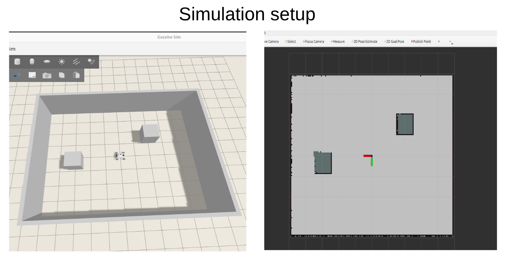
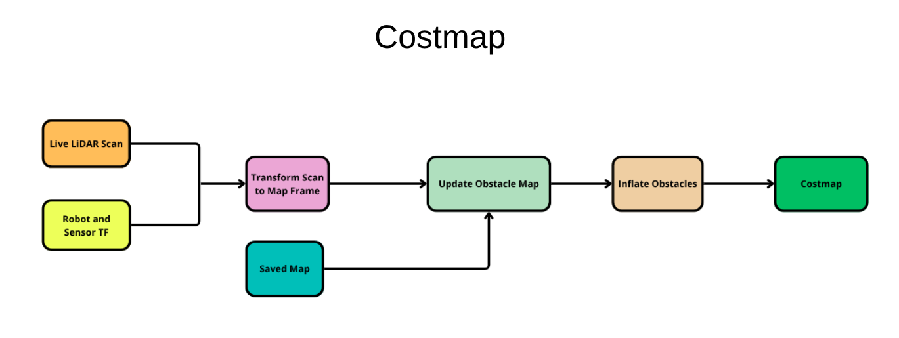
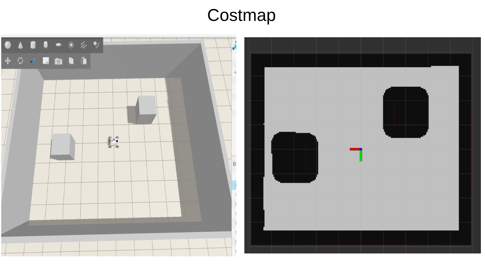
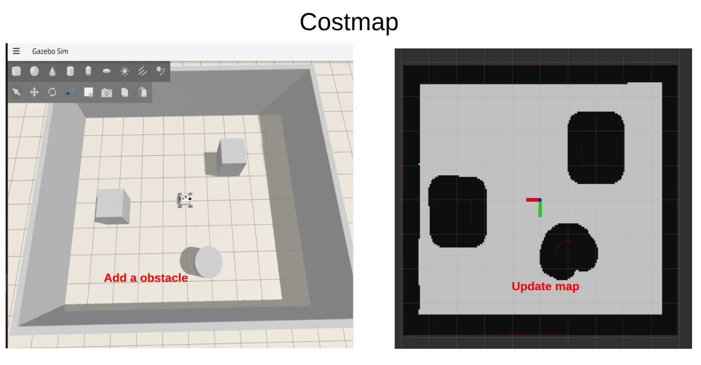
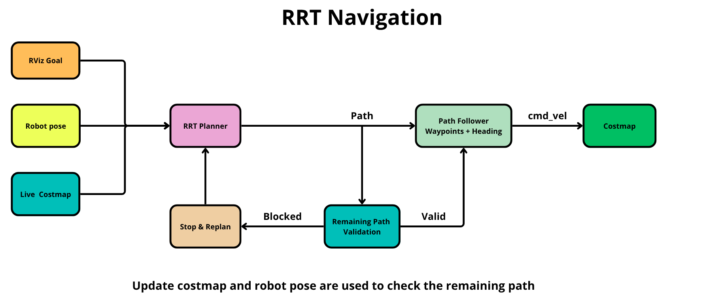
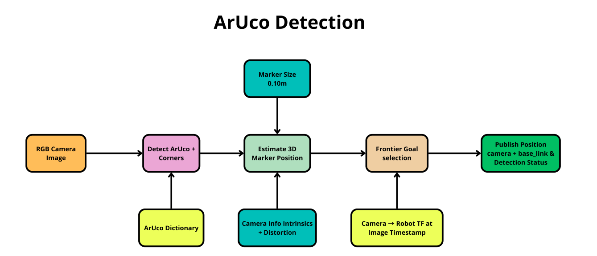
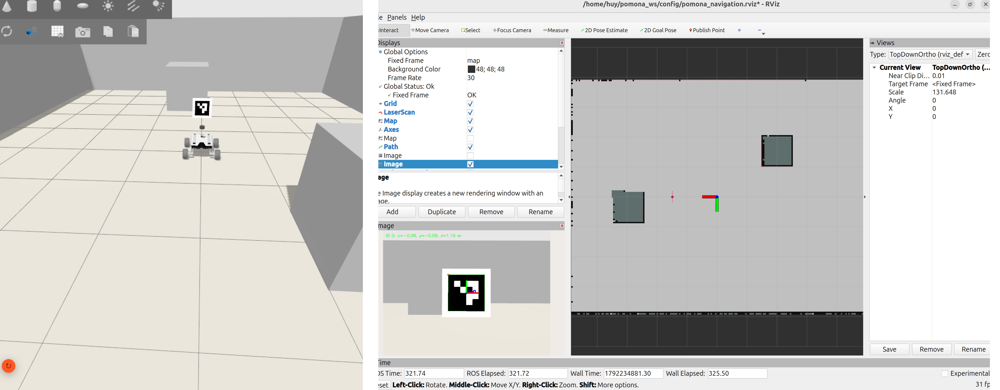
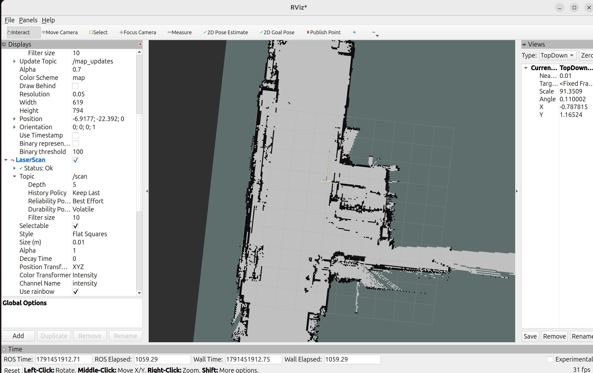
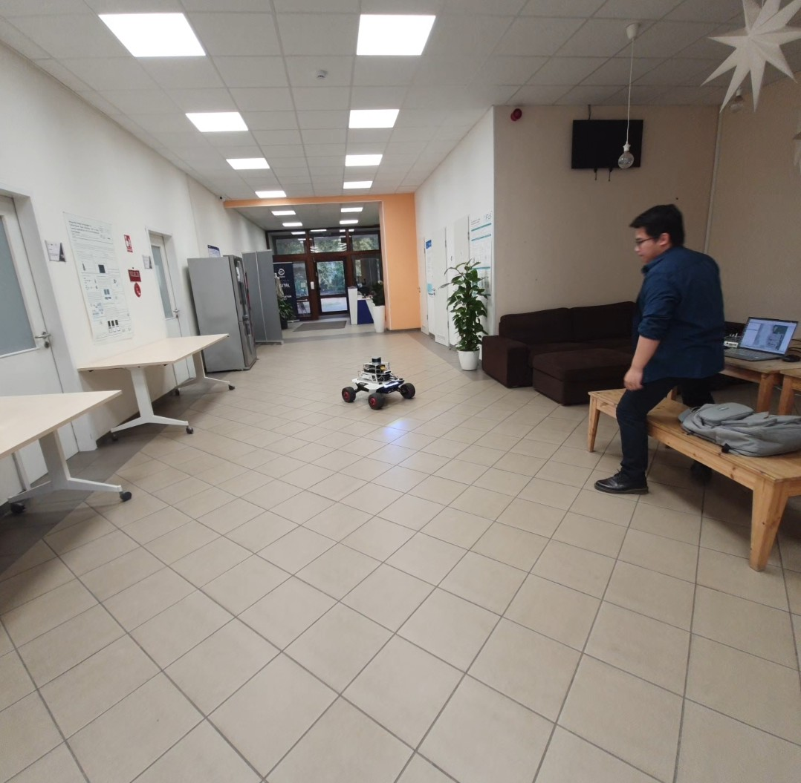
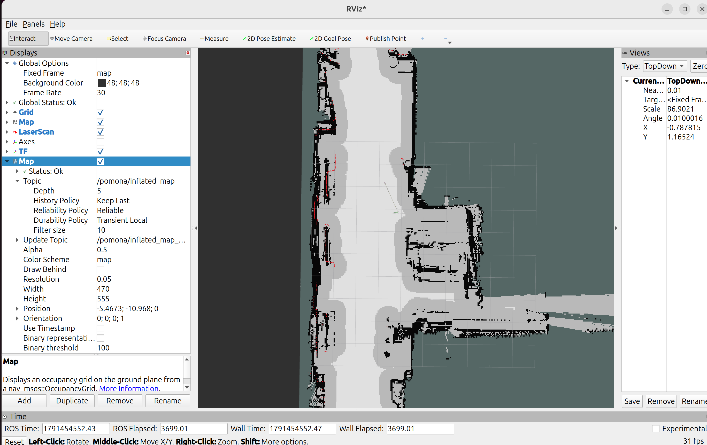

# Hospital Medication Delivery Robot — IFRoS 2026

A mobile robot navigation project for hospital medication delivery,
using the Pomona platform and a ROS 2 simulation environment.

The system combines LiDAR-based mapping and obstacle monitoring,
ArUco-based destination identification, RRT path planning, and
waypoint tracking.

## 1. Project Scope

The project investigates autonomous navigation toward delivery
locations identified by ArUco markers.

Development includes simulation and preliminary testing on the
physical Pomona robot. End-to-end ArUco-based navigation on the
physical robot remains under development.

The navigation system is intended to:

- Localize the robot within a previously constructed map.
- Combine the saved map with live LiDAR observations.
- Generate navigation goals from detected ArUco markers.
- Plan and follow paths while responding to newly detected obstacles.
- Stop at the destination with the required final heading.

## 2. System Architecture


The perception pipeline estimates the position of an ArUco marker
and transforms it into the map frame. A navigation goal is generated
at a specified stand-off distance from the marker.

The navigation pipeline constructs an inflated obstacle map,
plans a path using RRT, and produces velocity commands through
waypoint tracking.

## 3. Simulation Environment

| Component | Configuration |
|---|---|
| Operating system | Ubuntu 24.04 LTS |
| ROS distribution | ROS 2 Jazzy |
| Simulator | Gazebo Harmonic |
| Robot model | AgileX Scout Mini |
| Sensors | Simulated 2D LiDAR and RGB camera |
| Visualization | RViz2 |
| Mapping and localization | SLAM Toolbox |

The test environment contains an enclosed room and two static
obstacles. Additional obstacles can be introduced during execution
to evaluate live obstacle updates and replanning.

## 4. Mapping and Localization



A 2D occupancy grid was constructed from simulated LiDAR observations.
The saved map is subsequently used for localization and navigation.

The map resolution is 0.05 m per cell. The saved artifacts include
the occupancy grid, map metadata, and the serialized SLAM pose graph.

## 5. Costmap Generation



The costmap combines the saved occupancy grid with live LiDAR
observations transformed into the map frame.

Obstacles are inflated to account for the robot size and an
additional clearance margin. Unknown regions are treated as
non-traversable.

### Static obstacle inflation



The inflated regions around walls and obstacles restrict the
space available to the path planner.

### Live obstacle updates



An obstacle introduced into the simulation is detected by LiDAR
and incorporated into the costmap.

This updated representation supports path validation and replanning.
The current system responds to observed obstacles; it does not
predict their future trajectories.

## 6. Navigation and Visual Goals

The implemented simulation pipeline includes:

- RRT path planning and remaining-path validation.
- Replanning when the remaining path becomes invalid.
- Waypoint tracking with final heading alignment.
- ArUco detection and marker position estimation.
- Stand-off goal generation from the marker position.

Demonstration videos and detailed results will be added progressively.

### 6.1 RRT Planning and Waypoint Following

The planner generates a path from the robot pose to a manually selected
RViz goal using the inflated costmap. The follower tracks the waypoints
and aligns the robot with the final goal heading.



If the remaining path becomes blocked, the follower stops and the
planner searches for a new path.


#### Static Obstacle Demonstration

The robot follows an RRT-generated path around a static obstacle
and reaches the manually selected goal.

[Watch the static obstacle demonstration](https://youtu.be/GIDDxgE9hFs)

#### Dynamic Obstacle Demonstration

An obstacle is introduced while the robot is moving. The robot stops
when the remaining path becomes blocked, replans, and resumes navigation
toward the goal.

[Watch the dynamic obstacle demonstration](https://youtu.be/ZddsLquEFZQ)

Both demonstrations use manually selected RViz goals.
ArUco detection and marker-based goal generation are described below.

### 6.2 ArUco Detection and Marker-Based Goals

ArUco markers identify delivery destinations. The visual pipeline
detects the target marker, estimates its position, and transforms
that position into the map frame for navigation goal generation.

#### Detection Pipeline



The detector extracts the marker ID and image corners.
Camera calibration and the known marker size support estimation
of the marker position relative to the camera.

The ideal pinhole projection model is:

```math
s\begin{bmatrix}u\\v\\1\end{bmatrix} = K\left(Rp_{\mathrm{marker}}+t\right)
```

Here, $K$ is the camera intrinsic matrix, while $R$ and $t$
describe the marker pose relative to the camera.
Lens distortion is omitted from this expression for clarity.

#### Coordinate Transformation

The marker position is transformed into the map frame:

```math
p_{\mathrm{map}} = R_{\mathrm{map}\leftarrow\mathrm{camera}}p_{\mathrm{camera}} + t_{\mathrm{map}\leftarrow\mathrm{camera}}
```

TF provides the coordinate transformations between the camera,
robot, and map frames.

#### Stand-Off Goal Generation

A navigation goal is placed before the marker, maintaining
a configured horizontal stand-off distance.

For horizontal marker position $m$, robot position $r$, and
stand-off distance $d$, the geometric construction is:

```math
g = m - d\frac{m-r}{\lVert m-r\rVert}
```

This construction requires the robot–marker distance to exceed
the stand-off distance.

The final goal heading faces the marker:

```math
\theta_g = \mathrm{atan2}(m_y - g_y,\; m_x - g_x)
```

The goal is checked against the inflated costmap before navigation.
RRT plans a path toward the goal, and the follower tracks the
waypoints and aligns the final heading.

#### Simulation Result



The figure shows the ArUco detection result in simulation.
The detected marker provides the visual reference for
destination identification and marker-based goal generation.

### 6.3 Integrated ArUco-Guided Navigation in Simulation

The final simulation stage integrates ArUco detection with navigation.
The robot detects the delivery marker, estimates its position in the
map frame, and generates a goal at a configured distance from the marker.
The RRT planner uses the inflated costmap to find a path, and the
follower tracks the waypoints and turns the robot to face the marker
at the destination.

#### Static Obstacle Demonstration

An obstacle is already present when navigation starts. The planner
finds a route around it, and the robot follows the path to the
ArUco-based goal.

[Watch ArUco-guided navigation around a static obstacle](https://youtu.be/LF4NQrMUpZU)

#### Dynamic Obstacle Demonstration

An obstacle is introduced while the robot is moving. When the updated
costmap shows that the remaining path is blocked, the robot stops,
replans, and follows the new path toward the same ArUco-based goal.

[Watch ArUco-guided navigation with obstacle-triggered replanning](https://youtu.be/AlVZ5d2dU_M)

## 7. Installation and Usage

### 7.1 Simulation

The simulation runs on Ubuntu 24.04 with ROS 2 Jazzy and Gazebo Sim.

See the [Simulation Guide](simulation/README.md) for dependencies,
workspace requirements, launch commands, and goal submission.

### 7.2 Physical Robot

The physical Pomona robot runs the perception and navigation nodes
inside an ARM64 ROS 2 Jazzy Docker environment, while retaining
its existing Ubuntu 18.04 and ROS 1 installation.

See the [Real-Robot Guide](real_robot/README.md) for the tested
nodes, dependencies, deployment layout, localization setup,
and commands for ArUco detection, goal submission, RRT planning,
and waypoint following.

The guide assumes that the existing hardware bringup, sensor
configuration, and saved map are available on the robot.

## 8. Real-Robot Deployment and Preliminary Results

Preliminary tests have been conducted on the physical Pomona robot
using an ARM64 ROS 2 Jazzy Docker environment. These tests cover
LiDAR mapping, localization using the saved map, and costmap generation.

### 8.1 Real-World Mapping



A 2D occupancy grid was constructed from real LiDAR observations
using SLAM Toolbox, with a resolution of 0.05 m per cell.

The occupancy grid, map metadata, and serialized SLAM pose graph
were saved for subsequent localization and testing.

### 8.2 Physical Test Environment



The physical environment shown above was used for the preliminary
mapping and navigation tests.

These tests provide an initial assessment of the system outside
simulation; systematic performance evaluation is still pending.

### 8.3 Costmap on the Real-World Map



The saved real-world map was combined with live LiDAR observations
to generate an inflated costmap.

The inflated regions provide clearance around observed obstacles
for path planning and path validation.

### 8.4 RRT Navigation on the Physical Robot

Preliminary navigation tests were conducted on the physical Pomona
robot using the real-world map and inflated costmap.

Both demonstrations use manually selected RViz goals.

#### Static Obstacle Demonstration

The robot follows an RRT-generated path around a static obstacle
toward the selected goal.

[Watch the real-robot static obstacle demonstration](https://www.youtube.com/watch?v=lCJOzrNftY8)

#### Obstacle Replanning Demonstration

The robot stops when an observed obstacle blocks the remaining
path, replans, and resumes navigation toward the selected goal.

[Watch the real-robot obstacle replanning demonstration](https://www.youtube.com/watch?v=3FvcT5MC94o)

These demonstrations provide preliminary evidence of RRT planning,
waypoint following, and obstacle-triggered replanning on the
physical robot. Quantitative evaluation remains pending.

### 8.5 ArUco Detection on the Physical Robot

ArUco detection and marker position estimation were tested using
the RGB camera on the physical Pomona robot. The test uses
marker ID 0 from the DICT_6X6_1000 dictionary, with a marker
side length of 0.10 m.

The video demonstrates marker detection on real camera images.
This demonstration focuses on perception; integration with
RRT navigation is evaluated separately.

[Watch the real-robot ArUco detection video](https://youtu.be/zPUx9dybaDI)

### 8.6 Integrated Perception and Navigation — Upcoming Results

An initial real-robot trial demonstrated navigation toward an
ArUco-based goal without additional obstacles.

Further demonstrations will cover the complete pipeline:
ArUco detection, marker-based goal generation, RRT planning,
and waypoint following in the presence of static obstacles
and obstacles introduced during motion.

Videos will be added to document obstacle-triggered stopping,
replanning, and navigation toward the delivery goal.

## 9. Experimental Evaluation

The initial figures document mapping, obstacle inflation, and
live costmap updates.

Further evaluation will report:

- Goal completion rate.
- Navigation duration.
- Number of replanning events.
- Final position and heading errors.

## 10. Limitations and Next Steps

- Quantitative evaluation is still pending.
- Real-robot tests have demonstrated RRT navigation around static
  obstacles and replanning when the remaining path becomes blocked.
  Reliability across repeated trials has not yet been quantified.
- Current demonstrations use manually selected RViz goals.
- Costmap update timing and camera data transmission require
  further investigation.
- Moving obstacle trajectory prediction is outside the current scope.

The next steps are to implement ArUco-based destination identification
on the physical robot, integrate marker-based goals with navigation,
and conduct repeatable experiments to evaluate goal completion rate,
navigation duration, replanning events, and final pose errors.

## 11. References and Acknowledgements

The simulation environment builds on
[ugv_gazebo_sim](https://github.com/mattiadutto/ugv_gazebo_sim),
using the `jazzy-harmonic` branch.

Additional software references and attribution will be added
alongside the implementation.
