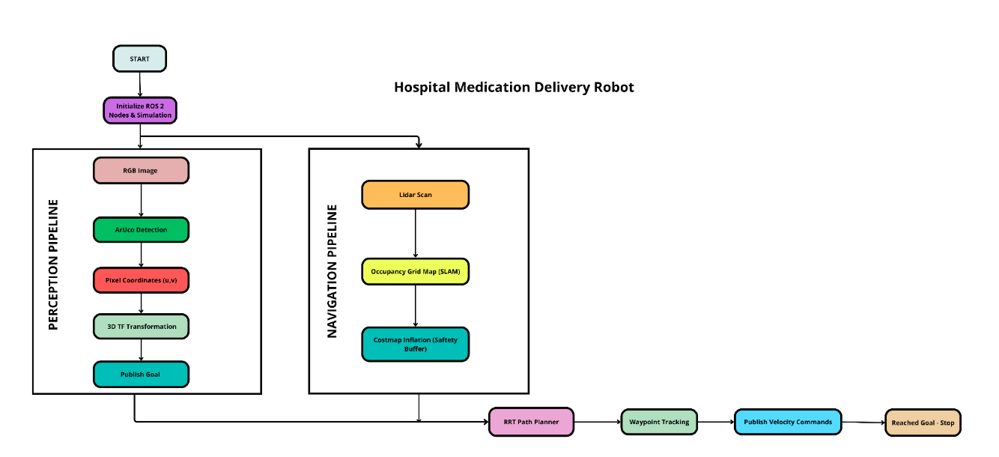

# Hospital Medication Delivery Robot — IFRoS 2026

A mobile robot navigation project for hospital medication delivery,
using the Pomona platform and a ROS 2 simulation environment.

The system combines LiDAR-based mapping and obstacle monitoring,
ArUco-based destination identification, RRT path planning, and
waypoint tracking.

## 1. Project Scope

The project investigates autonomous navigation toward delivery
locations identified by ArUco markers.

Development currently focuses on simulation. Deployment on the
physical Pomona robot is planned as the next stage.

The navigation system is intended to:

- Localize the robot within a previously constructed map.
- Combine the saved map with live LiDAR observations.
- Generate navigation goals from detected ArUco markers.
- Plan and follow paths while responding to newly detected obstacles.
- Stop at the destination with the required final heading.

## 2. System Architecture

The perception pipeline estimates the position of an ArUco marker
and transforms it into the map frame. A navigation goal is generated
at a specified stand-off distance from the marker.

The navigation pipeline constructs an inflated obstacle map,
plans a path using RRT, and produces velocity commands through
waypoint tracking.

## 3. Simulation Environment

| Component | Configuration |
|---|---|
| Operating system | Ubuntu 24.04 LTS |
| ROS distribution | ROS 2 Jazzy |
| Simulator | Gazebo Harmonic |
| Robot model | AgileX Scout Mini |
| Sensors | Simulated 2D LiDAR and RGB camera |
| Visualization | RViz2 |
| Mapping and localization | SLAM Toolbox |

The test environment contains an enclosed room and two static
obstacles. Additional obstacles can be introduced during execution
to evaluate live obstacle updates and replanning.

## 4. Mapping and Localization

A 2D occupancy grid was constructed from simulated LiDAR observations.
The saved map is subsequently used for localization and navigation.

The map resolution is 0.05 m per cell. The saved artifacts include
the occupancy grid, map metadata, and the serialized SLAM pose graph.

## 5. Costmap Generation

The costmap combines the saved occupancy grid with live LiDAR
observations transformed into the map frame.

Obstacles are inflated to account for the robot size and an
additional clearance margin. Unknown regions are treated as
non-traversable.

### Static obstacle inflation

The inflated regions around walls and obstacles restrict the
space available to the path planner.

### Live obstacle updates

An obstacle introduced into the simulation is detected by LiDAR
and incorporated into the costmap.

This updated representation supports path validation and replanning.
The current system responds to observed obstacles; it does not
predict their future trajectories.

## 6. Navigation and Visual Goals

The implemented simulation pipeline includes:

- RRT path planning and remaining-path validation.
- Replanning when the remaining path becomes invalid.
- Waypoint tracking with final heading alignment.
- ArUco detection and marker position estimation.
- Stand-off goal generation from the marker position.

Demonstration videos and detailed results will be added progressively.
### 6.1 RRT Planning and Waypoint Following

The planner generates a path from the robot pose to a manually selected
RViz goal using the inflated costmap. The follower tracks the waypoints
and aligns the robot with the final goal heading.

If the remaining path becomes blocked, the follower stops and the
planner searches for a new path.

#### Static Obstacle Demonstration

The robot follows an RRT-generated path around a static obstacle
and reaches the manually selected goal.

[Watch the static obstacle demonstration](VIDEO_URL_STATIC)

#### Dynamic Obstacle Demonstration

An obstacle is introduced while the robot is moving. The robot stops
when the remaining path becomes blocked, replans, and resumes navigation
toward the goal.

[Watch the dynamic obstacle demonstration](VIDEO_URL_DYNAMIC)

Both demonstrations use manually selected RViz goals.
ArUco-based goal generation will be documented separately.

## 7. Installation and Usage

### 7.1 Simulation

The simulation runs on Ubuntu 24.04 with ROS 2 Jazzy and Gazebo Sim.

See the [Simulation Guide](simulation/README.md) for dependencies,
workspace requirements, launch commands, and goal submission.

### 7.2 Physical Robot

The physical Pomona robot uses an ARM64 ROS 2 Jazzy Docker environment
while retaining its existing Ubuntu 18.04 and ROS 1 installation.

Hardware setup, sensor configuration, and mapping instructions
will be documented in a dedicated real-robot guide.
## 8. Real-Robot Deployment and Preliminary Results

## 9. Experimental Evaluation

The initial figures document mapping, obstacle inflation, and
live costmap updates.

Further evaluation will report:

- Goal completion rate.
- Navigation duration.
- Number of replanning events.
- Final position and heading errors.

## 10. Limitations and Next Steps

- Quantitative evaluation is still being consolidated.
- Physical robot deployment has not yet been validated.
- ROS 1 / ROS 2 integration must be resolved before deployment
  on the current Pomona robot.
- Moving obstacle trajectory prediction is outside the current scope.

The next steps are to archive simulation results, document the
implementation, and evaluate integration with the physical robot.

## 11. References and Acknowledgements

The simulation environment builds on
[ugv_gazebo_sim](https://github.com/mattiadutto/ugv_gazebo_sim),
using the `jazzy-harmonic` branch.

Additional software references and attribution will be added
alongside the implementation.
